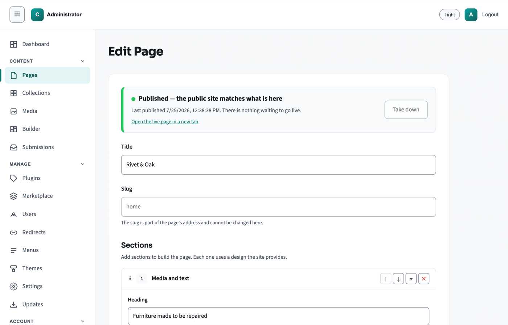

# Click CMS Demos — Deutsch

[English](demos-en.md) · [Deutsches Handbuch](handbook-de.md)

Dies sind praktische Anleitungen, kein öffentlich gehosteter Testzugang. Verwenden Sie eine lokale Testinstallation oder eine isolierte Staging-Kopie. Beispieldaten und Wiederherstellungsübungen gehören nicht auf die Produktionswebsite. Planen Sie nach der Installation etwa 30 Minuten ein.

## Lokale Installation vorbereiten

Führen Sie in einem Click-Quellcode-Checkout mit installiertem Docker aus:

```bash
docker compose up -d --build
docker compose ps
```

Öffnen Sie die Adresse Ihrer Compose-Konfiguration; standardmäßig lautet sie `http://localhost:8080/admin/`. Nur bei einer frischen Installation melden Sie sich mit `admin` / `admin` an und wählen sofort ein eigenes, sicheres Passwort. Stellen Sie diese Installation nicht mit den Erstzugangsdaten ins Internet.

Ermitteln Sie den Containernamen mit `docker compose ps` und ersetzen Sie den Platzhalter. Beispieldaten werden mit dem Benutzer des Webservers angelegt:

```bash
docker exec -u www-data CONTAINER_NAME php bin/click-seed.php --dry-run
docker exec -u www-data CONTAINER_NAME php bin/click-seed.php
```

Vorhandene Dokumente werden übersprungen. Prüfen Sie, ob Beispielseiten vorhanden sind. Ihre Abschnitte können von den Screenshots abweichen. Alternativen: [Release-Archiv und Quellcode auf Englisch](install.md).

## Demo 1: Seite bearbeiten und prüfen

**Zielgruppe:** Editor oder Administrator. **Dauer:** 10 Minuten.

1. Öffnen Sie unter **Pages** eine Beispielseite. Notieren Sie Slug und bisherige öffentliche Überschrift.
2. Ändern Sie ein Textfeld in „Unser nächstes Kapitel“. Speichern Sie mit **Save**.
3. Prüfen Sie den neuen Text in der Entwurfsvorschau. Öffnen Sie die öffentliche Seite separat.
4. Bei einer bereits veröffentlichten Seite muss dort weiterhin der bisherige Text stehen. Eine noch nie veröffentlichte Seite darf öffentlich nicht verfügbar sein.
5. Veröffentlichen Sie mit **Publish**. Laden Sie die öffentliche Seite neu und prüfen Sie den neuen Text.
6. Prüfen Sie die Vorschau bei schmaler Bildschirmbreite sowie geänderte Links.

**Ergebnis:** Entwurf und öffentliche Fassung bleiben getrennt; die Veröffentlichung aktualisiert die öffentliche Seite.



## Demo 2: Freigabe, Verlauf und Zurückziehen

**Zielgruppe:** Administrator und separates Autorenkonto. **Dauer:** 10 Minuten.

1. Legen Sie unter **Users** ein Autoren-Testkonto an und melden Sie es in einem separaten Browserprofil an.
2. Erstellen Sie als Autor eine Seite mit eindeutigem Demo-Slug, fügen Sie einen Abschnitt hinzu und speichern Sie. Prüfen Sie, dass der Autor nicht veröffentlichen kann.
3. Teilen Sie die Vorschau vertraulich mit dem Administrator. Prüfen und veröffentlichen Sie als Administrator.
4. Ändern und speichern Sie als Administrator einen Text. Öffnen Sie den Verlauf und stellen Sie die vorherige Fassung wieder her. Prüfen Sie den Entwurf vor einer erneuten Veröffentlichung.
5. Ziehen Sie die Veröffentlichung zurück. Prüfen Sie, dass die öffentliche URL nicht mehr verfügbar ist, die Seite unter **Pages** aber bearbeitbar bleibt.

**Ergebnis:** Autoren können die Freigabe nicht umgehen, der Verlauf stellt Entwürfe wieder her und das Zurückziehen erhält Inhalte. Entfernen Sie anschließend Demo-Seite und Testkonto.

## Demo 3: Bilder, Übersetzung und Navigation

**Zielgruppe:** Administrator. **Dauer:** 5 Minuten.

1. Laden Sie unter **Media** ein unbedenkliches Beispielbild hoch. Wählen Sie es in einem Abschnitt und geben Sie eine sinnvolle Bildbeschreibung ein.
2. Prüfen Sie Bildausschnitte auf Desktop und Mobilgerät, speichern und veröffentlichen Sie.
3. Wenn eine zweite Sprache eingerichtet ist, wählen Sie diese und übersetzen Sie die Texte. Speichern und veröffentlichen Sie diese Sprachfassung. Prüfen Sie beide Sprachadressen sowie gegebenenfalls den Sprachersatz in der API.
4. Fügen Sie die veröffentlichte Seite unter **Menus** zum passenden Menü hinzu. Prüfen Sie den Link dort, wo das Theme dieses Menü anzeigt.
5. Falls Sammlungen vorhanden sind, erstellen Sie einen Beispieleintrag mit allen Pflichtfeldern und prüfen Sie die veröffentlichte Darstellung.

**Ergebnis:** Das Bild ist zugänglich, die gewünschten Übersetzungen werden ausgeliefert und die Navigation erreicht die Seite. Sprachen, Sammlungsfelder und Menüdarstellung hängen von der Website ab. Dokumentieren Sie nicht verfügbare Schritte.

## Demo 4: Veröffentlichte Inhalte für eine SPA lesen

**Zielgruppe:** Entwickler. **Dauer:** 5 Minuten. Erfordert ein laufendes CMS mit aktivierter Delivery-API und einer veröffentlichten Seite.

Ersetzen Sie Basisadresse und Slug. Führen Sie das Beispiel in einer Browserkonsole eines erlaubten Ursprungs oder mit Node und globalem `fetch` aus:

```javascript
const cmsBase = 'http://localhost:8080';
const slug = 'home';
const response = await fetch(`${cmsBase}/api/pages/${encodeURIComponent(slug)}`);
if (response.status === 404) {
  console.log('Seite fehlt oder ist unveröffentlicht');
} else if (response.status === 503) {
  console.log('CMS vorübergehend nicht verfügbar; später erneut versuchen');
} else if (!response.ok) {
  throw new Error(`CMS-Anfrage fehlgeschlagen: ${response.status}`);
} else {
  const payload = await response.json();
  console.log(payload);
}
```

Prüfen Sie die tatsächliche Antwortstruktur vor der Darstellung. Der [typisierte Client auf Englisch](../sdk/typescript/README.md) dokumentiert sie. Das Beispiel protokolliert Inhalte, statt HTML direkt einzufügen.

**Ergebnis:** Veröffentlichte Inhalte sind ohne Administratorzugang lesbar. Ziehen Sie die Testseite zurück und prüfen Sie, dass die Anfrage sie nicht mehr ausliefert. Testen Sie im separaten Frontend zusätzlich CORS, fehlende Übersetzungen, Wartungsfehler und die Nicht-gefunden-Darstellung. Prüfen Sie bei statischen Websites auch den signierten Webhook und den anschließenden Neubau.

## Betreiberübung: Updates und Wiederherstellung

Verwenden Sie eine separate Kopie mit eigenen beschreibbaren Inhalts- und Datenverzeichnissen, ohne Produktionszugänge, aktive Produktions-Webhooks oder öffentliche Besucher. Sichern Sie die Kopie und notieren Sie Version und Richtlinie. Installieren Sie nach der [Update-Anleitung auf Englisch](updates.md) ein tatsächlich neueres kompatibles signiertes Release. Prüfen Sie danach Version, Anmeldung, Seiten, Sprachen, Medien und Delivery-API. Testen Sie eine Wiederherstellung nach der [Sicherungsanleitung auf Englisch](backup.md).

Die neueste Version kann kein tatsächliches Upgrade demonstrieren. Dokumentieren Sie diese Grenze. Erzwingen Sie keine Demo durch Downgrade oder abgeschaltete Signaturprüfung. Ohne Shell-Zugriff verwenden Sie die Admin-Update-Steuerung und die Dateiverwaltung des Hosts oder den freigegebenen Deployment-Prozess.

## Beenden und aufräumen

```bash
docker compose down
```

Damit stoppen Sie die lokale Umgebung. Behalten Sie die Volumes bis zum Abschluss der Prüfung. Löschen Sie Demo-Dokumente und Testkonten nur in der isolierten Installation. Notieren Sie bei Abnahmetests Click-Version, Browser, Rolle, Sprache und tatsächliches Ergebnis jeder Demo.
